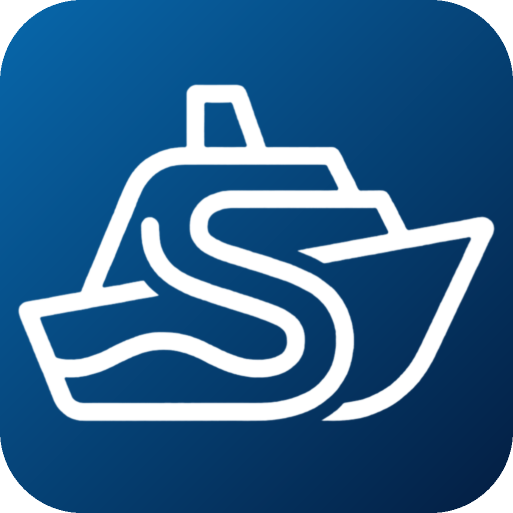
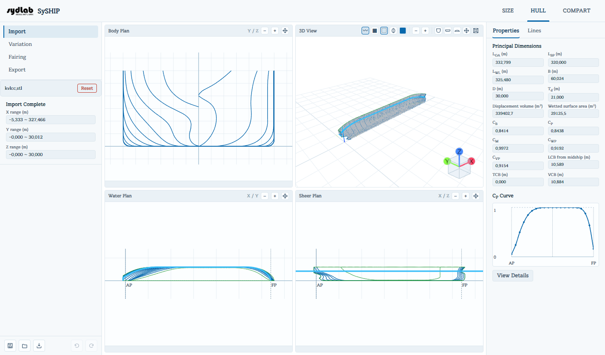
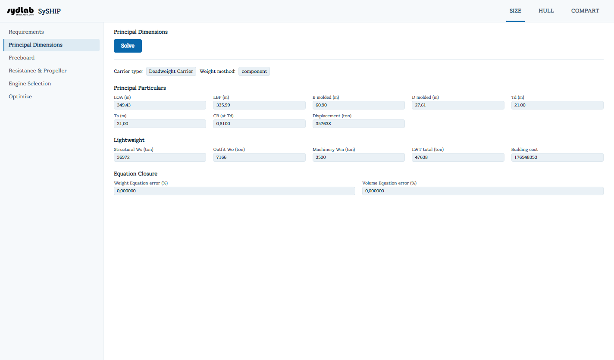
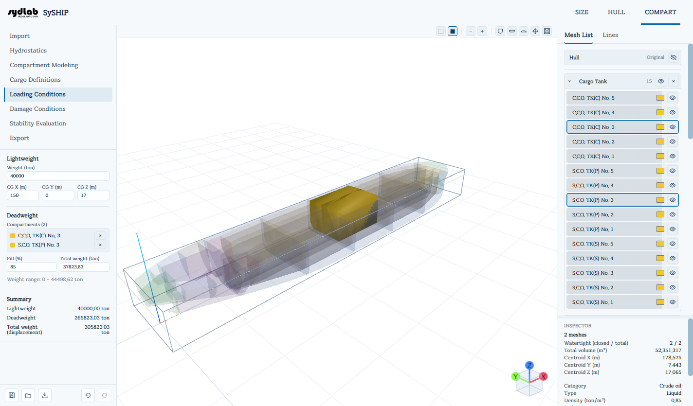

<div align="center">



# SySHIP

**Early-stage ship design, from owner's requirements to damage stability, in one desktop app.**

[](https://github.com/Domiki/SySHIP/releases)
[](https://github.com/Domiki/SySHIP/releases/latest)
[](#download)
[](https://syship.readthedocs.io)
[](#license)

[Download](#download) · [Quick start](#quick-start) · [Documentation](https://syship.readthedocs.io) · [Report an issue](https://github.com/Domiki/SySHIP/issues)

<br />



</div>

<br />

## Overview

SySHIP is a desktop application for the concept and preliminary design of ships, developed at the Seoul National University Ship Design Laboratory (**SyDLab**). It follows the way a design actually progresses: size a new ship from the owner's requirements, take a hull surface and reshape it toward the target dimensions, then lay out the internal compartments and check hydrostatics, loading, and damage stability, without leaving the application.

The app is organized into three stages that you can work through in order (or enter at any point):

| Stage | What it does |
|---|---|
| **SIZE** | Size a new design from owner's requirements and a parent ship: principal dimensions, freeboard, resistance and propeller, engine selection, and automatic optimization. |
| **HULL** | Import an STL hull, generate its lines plan, reshape it with free-form deformation, fair it, and export STL or DXF. |
| **COMPART** | Model compartments and tanks inside the hull, then run hydrostatics, loading conditions, damage cases, and stability evaluation against IMO, MARPOL, and ICLL criteria. |

<div align="center">


</div>

## Features

**SIZE: concept sizing**
- Requirements-driven sizing from a parent (basis) ship
- Principal dimensions, freeboard, resistance and propeller estimates, engine selection
- Automatic optimization toward an objective of your choice

**HULL: hull form**
- STL import with scale and orientation, plus automatic stations, waterlines, and buttocks
- Free-form-deformation **variation** toward target dimensions and Cp curve, with protected regions
- Line **fairing** and STL / DXF export

**COMPART: compartments and stability**
- Compartment modeling with boxes, cylinders, planes, lofted surfaces, boolean operations, and batch scripts
- Hydrostatics over a draft / trim / heel sweep, with a shell-thickness allowance
- Cargo definitions (category, reduction, filling, permeability) and loading conditions with lightweight, deadweight, and displacement summary
- Damage conditions and stability evaluation with a rule library you can edit, covering IMO, MARPOL, and ICLL criteria
- Merged STL export of the modeled compartments

**Automation**
- The full `syship` command line: script repeated studies, drive SySHIP from Python, or let an AI agent operate it. The window shows each command as it runs, or run headless for speed.

**Bilingual documentation** in English and Korean.

## Download

Grab the latest installer from the **[Releases](https://github.com/Domiki/SySHIP/releases/latest)** page.

| Platform | File |
|---|---|
| Windows | `SySHIP-<version>-Windows.exe` |
| macOS | `SySHIP-<version>.dmg` |

The app is not yet code-signed (Windows) or notarized (macOS), so the first launch may show a security warning. The [FAQ](https://syship.readthedocs.io/en/latest/faq/) has the one-time fix for each system.

## Quick start

1. **Install** SySHIP and launch it. See [Installation](https://syship.readthedocs.io/en/latest/installation/) for per-platform steps.
2. Open the **HULL** stage and **Import** one of the bundled sample hulls (`kvlcc.stl`, `kvlcc2.stl`, or `kcs.stl`). The file browser opens to the samples folder.
3. Follow the Import steps to set scale, AP / FP, and generate the lines. The body plan, water plan, sheer plan, and 3D view update live.
4. Switch to **COMPART**, start a new project from the hull, model a few tanks, assign cargo categories, and run **Hydrostatics**, **Loading Conditions**, and **Stability Evaluation**.

Prefer the terminal? Once installed, `syship` is on your `PATH`:

```sh
syship serve --headless          # start a background instance
syship list                      # every available command
syship describe compart.loading.set
syship app.shutdown
```

## Documentation

Full documentation: **[syship.readthedocs.io](https://syship.readthedocs.io)** (English and 한국어)

| | |
|---|---|
| [Installation](https://syship.readthedocs.io/en/latest/installation/) | Install on Windows and macOS |
| [SIZE](https://syship.readthedocs.io/en/latest/size/) | Concept sizing from requirements |
| [HULL](https://syship.readthedocs.io/en/latest/hull/import/) | Import, variation, fairing, export |
| [COMPART](https://syship.readthedocs.io/en/latest/compart/) | Compartments, loading, damage, stability |
| [Command Line](https://syship.readthedocs.io/en/latest/cli/) | Automate SySHIP with `syship` |
| [FAQ](https://syship.readthedocs.io/en/latest/faq/) | Troubleshooting |

## Contributing

SySHIP's source code is not public, so this repository does not accept code contributions. You can still help:

- **Bug reports and feature requests**: open an [issue](https://github.com/Domiki/SySHIP/issues). Include your SySHIP version, operating system, and, when possible, the steps (and a sample file) to reproduce the problem.
- **Documentation fixes**: every documentation page has an edit link; pull requests against the files in [`docs/`](docs/) are welcome.

## License

SySHIP is proprietary software. It is distributed free of charge in binary form **for educational use only**, and its source code is not publicly available. Redistribution, reverse engineering, and commercial use are not covered by this distribution.

Copyright &copy; Seoul National University, SyDLab.

---

<sub>This repository hosts the public distribution, documentation, and update-check metadata (`latest.json`) for SySHIP. `latest.json` is read by the app on startup and is updated automatically by [`update-latest-json.yml`](update-latest-json.yml) whenever a GitHub Release is published.</sub>
