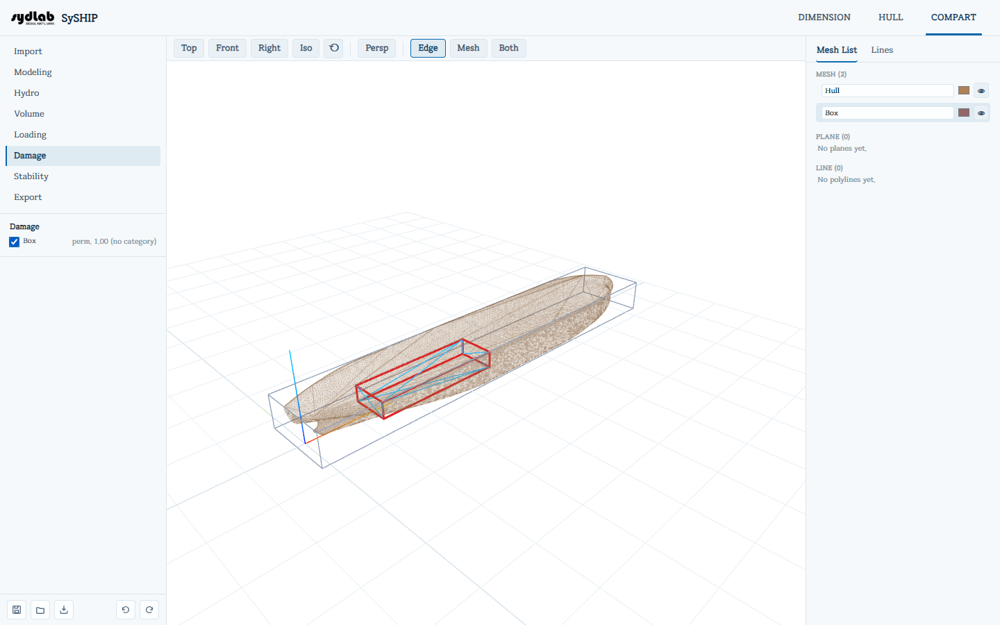

# Damage Conditions

손상 복원성 케이스를 위해 어느 구획이 손상(파손·침수)된 것으로 가정할지 표시합니다. 여기에 올린 구획은 각 구획 자체의 **Permeability**([Cargo Definitions](volume.md)에서 구획별로 설정)만큼 부력 용적에서 공제되며, 다음 [Stability Evaluation](stability.md) 실행에 반영됩니다. 목록이 비어 있으면 일반적인 **intact(비손상)** 복원성 계산이 되고, 하나 이상 올리면 Stability criteria 창이 intact 조건 대신 **MARPOL Annex I** / **ICLL Type A** 손상 조건이 켜진 상태로 시작합니다.

**Mesh List**에서 하나 이상의 구획을 **Damaged compartments** 드롭 박스로 드래그하면 침수 처리됩니다(선체와 절단면은 여기 드롭할 수 없으며, 시도하면 이유를 설명하는 안내가 표시됩니다). 각 행에는 ([Cargo Definitions](volume.md)에서 가져온) permeability가 읽기 전용으로 표시되며, × 버튼으로 손상 목록에서 제거할 수 있습니다.

[Loading Conditions](loading.md)에서 경하중량(Lightweight)을 입력하기 전에는 드롭 박스가 비활성화되고 "Define a Loading Condition first."가 표시됩니다. 무게가 있는 선박에 대해서만 손상 케이스가 의미 있기 때문입니다.

안정성 계산의 매 heel/trim/draft 시도마다, 침수 구획에서 수면 아래에 있는 부분을 잘라 permeability를 곱한 만큼 부력 용적에서 뺍니다(손실 부력법). 침수 구획에 실려 있던 화물은 유출된 것으로 보고 무게에서 제외합니다.

침수된 구획은 3D View에서 빨간색 외곽선으로 표시됩니다. [Stability Evaluation](stability.md)에서 평형 결과를 표시하면, 평형 흘수까지 평형 heel/trim에 맞춰 기울어진 반투명한 바닷물 색상 채움도 함께 표시됩니다.

개구부(침수점)는 모델링하지 않으므로, 침수각은 판정에 쓰이지 않습니다.