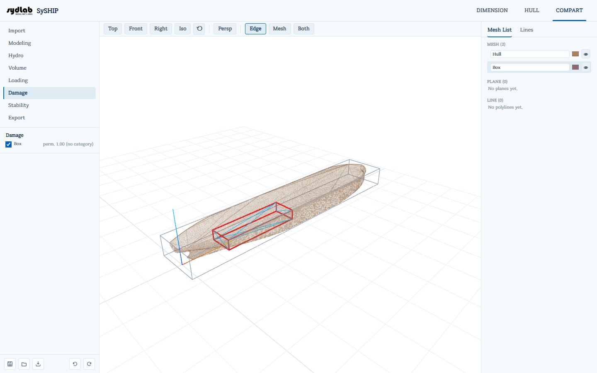

# Damage Conditions

Marks which compartments are assumed damaged (breached and flooded) for a damage-stability case.
Whatever is listed here becomes a deduction from buoyant volume — scaled by each
compartment's own **Permeability** (set per-compartment in [Cargo Definitions](volume.md)) — the next
time you run [Stability Evaluation](stability.md). Leave the list empty for an ordinary
**intact**-stability run; add one or more compartments and the Stability criteria window
starts with the **MARPOL Annex I** / **ICLL Type A** damage conditions instead of the intact
ones.

Drag one or more compartments from the **Mesh List** into the **Damaged compartments** drop
box to flood them (the hull and cutting surfaces can't be dropped here — a hint explains why
if you try). Each row shows its permeability read-only (from [Cargo Definitions](volume.md));
click the × to remove a compartment from the damaged set.

The drop box stays disabled ("Define a Loading Condition first.") until a lightweight has been
entered in [Loading Conditions](loading.md), since a damage case only makes sense for a ship
that has a weight.

At every trial heel/trim/draft of the stability solve, the part of each flooded compartment
below the waterline is cut out, multiplied by its permeability, and subtracted from the
buoyant volume (lost buoyancy). Any cargo loaded in a flooded compartment is treated as
lost and left out of the weight.

Damaged compartments get a red outline in the 3D View. When the equilibrium result is shown
in [Stability Evaluation](stability.md), they also show a translucent sea-colored fill up to the
equilibrium waterline, tilted to the equilibrium heel/trim.

Openings (down-flooding points) are not modeled, so the flooding angle is not used in the
criteria.