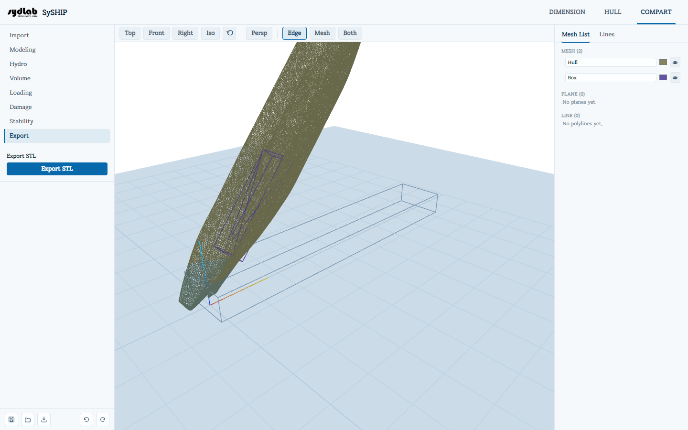

# Export

## Export STL

내보낼 대상을 고르고, 필요하면 원점을 지정한 뒤 **Export STL**을 누릅니다.

- **Hull shell only**는 HULL에서 임포트된 그대로의 선체 — 구획이나 Modeling 편집이 전혀 적용되지 않은 원본 watertight 외피 — 를 `<선체 이름>.stl`로 내려받습니다. 내부에 무엇을 만들었는지와 무관하게 외피 표면만 따로 필요할 때 유용합니다.
- **All compartments**는 모델링한 모든 구획을 **하나로 병합된 STL**(`compart_merged.stl`)로 내보냅니다 — SySHIP 밖에서 전체 구획 모델을 열어볼 때(3D 프린팅, CAD, CFD 등) 유용합니다. 인접한 구획끼리 공유하는 벽은 두 개의 겹친 면이 아니라 하나의 판으로 병합되며, 성공 메시지에 몇 개의 공유 벽이 병합되었는지 표시됩니다. 이 기능은 항상 모든 구획을 함께 병합합니다 — 아직은 구획 하나만 따로 내보내는 버튼은 없습니다.

**Origin (m)**에 좌표를 넣으면 그 점이 내보낸 파일에서 (0, 0, 0)이 되도록 전체를 옮겨서 내보냅니다 — 외부 툴이 쓰는 원점(예: 선박의 A.P., 중심선, 기선)에 맞출 때 유용합니다. 0, 0, 0 그대로 두면 SySHIP 안의 좌표를 그대로 씁니다.