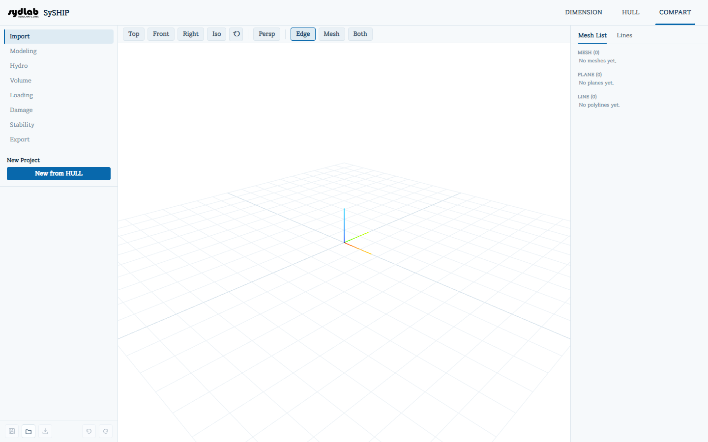

# COMPART

COMPART builds internal compartments and tanks inside an imported hull, then runs
hydrostatics, tank capacity/loading-factor accounting, loading conditions, damage/flooding
cases, and stability (righting-arm/GZ, with IMO/MARPOL/ICLL criteria evaluation)
calculations on the result.

## Sub-tabs

| Sub-tab | Purpose |
|---|---|
| [Import](import.md) | Start a new COMPART project from a hull imported in the HULL tab. |
| [Compartment Modeling](modeling.md) | Build compartment/tank solids (box, cylinder, plane, lofted surface, boolean operations, or a batch script) — Create / Operation / Script inner tabs. |
| [Hydrostatics](hydro.md) | Hydrostatic particulars over a sweep of draft/trim/heel, with the seawater density and an optional shell-thickness allowance. |
| [Cargo Definitions](volume.md) | Assign a compartment a cargo category and set its Reduction/Filling/Permeability loading factors. |
| [Loading Conditions](loading.md) | Set the lightweight and CG, and fill compartments (deadweight) to build a loading condition. |
| [Damage Conditions](damage.md) | Mark compartments as damaged (flooded) for a damage-stability case. |
| [Stability Evaluation](stability.md) | Solve the equilibrium heel/trim and righting-arm (GZ) curve, and evaluate it against stability criteria. |
| [Export](export.md) | Export the modeled compartments as a single merged STL. |

All sub-tabs except Import are disabled until a project exists (i.e., until you've run
"New from HULL" once).

## Shared UI

These elements are present on every COMPART sub-tab:

- **View toolbar**, above the 3D viewport — the same controls as HULL's 3D View: **Edge** /
  **Mesh** display toggles (independent, so both can be on at once), **Zoom Out/In**,
  camera-snap buttons for **Section View** / **Elevation View** / **Plan View** (using the
  same naval-architecture convention as HULL — viewed from aft/starboard), **Fit View**, and
  a **Persp/Ortho** projection toggle.
- **Mesh List** (right panel, next to a **Lines** tab): every mesh in the project, organized
  into drag-reorderable **layers** (plus a read-only "Unassigned" layer and, if present, the
  original imported hull shown separately). Each row has an editable name, a color swatch, and
  a show/hide button; right-click a row (or a multi-selection) for a **Rename / Copy /
  Delete** context menu. Clicking a row selects it — this is how you tell Compartment Modeling,
  Cargo Definitions, Loading Conditions, and Damage Conditions *which* compartment(s) to act
  on; Cargo Definitions and Loading Conditions list the compartments you have selected, and
  rows can be dragged directly into the drop boxes that Compartment Modeling and Damage
  Conditions show (Operation targets/cutters, damaged compartments). Below the list, an **Inspector** pane shows the current selection's watertight
  status, volume, centroid, category, and loading factors read-only. The **Lines** tab is a
  read-only copy of the hull's station/waterline/buttock lines (captured at import time) —
  click one to preview it as a cutting plane, or drag its value onto any numeric field
  elsewhere in COMPART to fill that field with the line's position.
- **Sticky footer** — Save / Load / Save As / Undo / Redo, same conventions as HULL's
  project actions bar; COMPART projects save as `.zip` files independent of the HULL
  project file.

Internally, all COMPART positions are stored in millimeters and shown to you in meters;
volumes in m³, areas in m², weights in ton, densities in ton/m³.