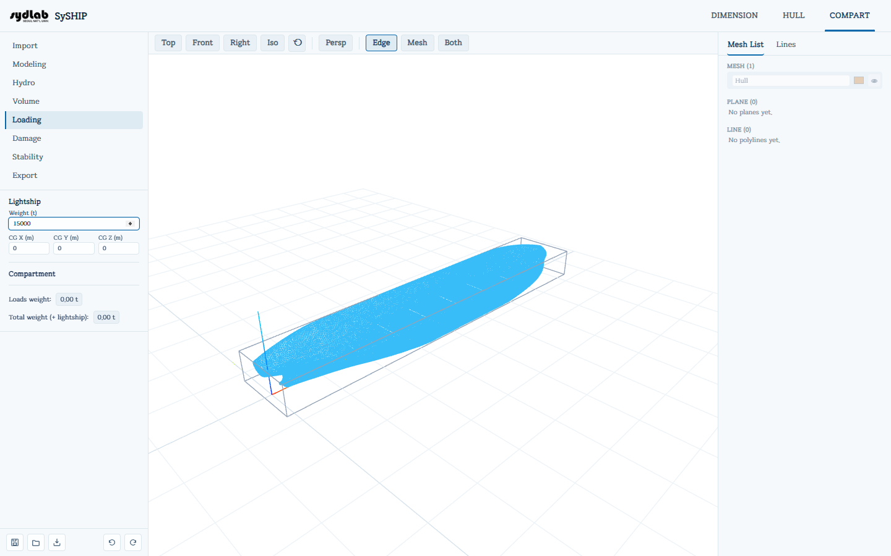

# Loading Conditions

Builds a loading condition: the ship's lightweight and CG plus the deadweight of however full
each categorized compartment is, combining into a total weight (displacement) and CG that
[Stability Evaluation](stability.md) solves against.

## Lightweight

- **Weight (ton)** and **CG X/Y/Z (m)**. A value is applied when you press Enter or move to
  another field; Escape restores the previous value.
- If a SIZE design ship exists and the weight is still 0, a **"Use SIZE estimate
  (N ton)"** button appears — one click fills it with Ws+Wo+Wm
  from [SIZE → Principal Dimensions](../size/principal-dimensions.md).
- Entering a lightweight is also what unlocks [Damage Conditions](damage.md).

## Deadweight

Select one or more compartments in the **Mesh List** — only ones that already have a category
assigned (in [Cargo Definitions](volume.md)) can be selected here; others are grayed out while
this tab is active. The **Compartments (N)** box lists the selected compartments (color
swatch, name, and a **×** that drops one from the selection). With a selection made:

- **Fill (%)** — a shared fill level for every selected compartment (shows "mixed" if the
  selection currently has different fill levels). Compartments always fill from the bottom
  upward.
- **Weight (ton)** (or **Total weight (ton)** for a multi-compartment selection) — the equivalent
  fill level's weight; editing it converts back to a fill percentage. A **Weight range: 0 –
  N ton** hint below it shows the maximum this selection can hold, computed from each
  compartment's own volume, **Reduction**, **Filling**, and category density (see
  [Cargo Definitions](volume.md) — the loadable volume at 100% fill is `volume × reduction × filling`,
  and its weight is that volume × the category's density).

Both fields apply when you press Enter or move to another field — there's no separate Apply
button.

## Summary

- **Lightweight** — the lightweight entered above.
- **Deadweight** — sum of every loaded compartment's weight.
- **Total weight (displacement)** — lightweight + deadweight. This total, and the combined center of
  gravity behind it, is exactly what [Stability Evaluation](stability.md) uses as the ship's weight/CG
  when solving for equilibrium.

Loaded compartments render as translucent colored solids in the 3D View, filled to the
correct surface for the current fill level.