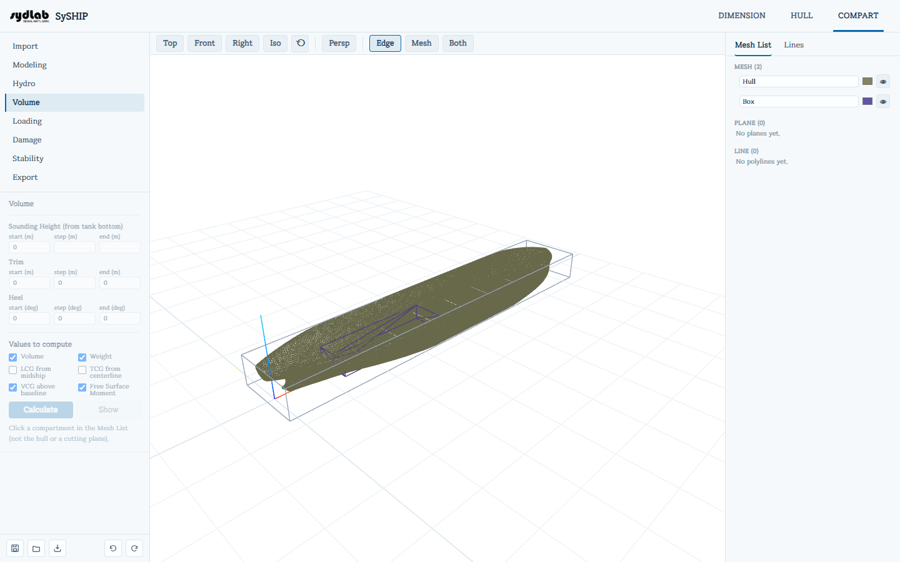
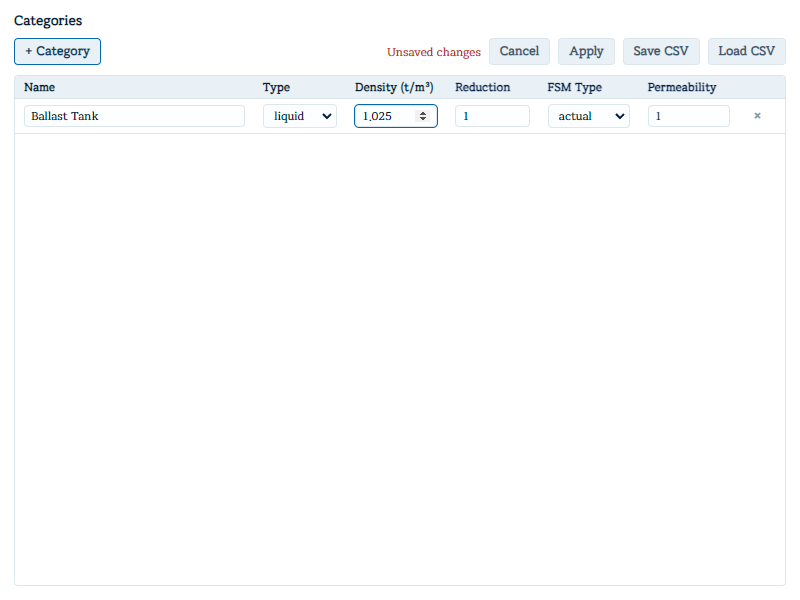

# Cargo Definitions

For one or more compartments at a time, assigns a cargo/contents **category** (a name, type,
density, and color) and sets three **loading factors** that control how much of the
compartment's raw geometric volume actually counts as cargo/ballast capacity or floodable
space.

Select one or more compartments in the **Mesh List** first — Cargo Definitions acts on whichever
mesh(es) are picked there (not the hull, and not a plane). The **Compartments (N)** box at the
top lists the compartments you have selected, each with its color swatch and a **×** that
drops it from the selection; with nothing selected it reads "Select compartments in the Mesh
List." Cutting surfaces (open meshes) are left out of the list.

## Cargo Category

- The **Cargo Category** dropdown lists every category defined so far, plus "No category" (shows
  "Mixed" if the current selection has different categories). Picking one assigns it to every
  selected compartment immediately; a hint below shows its type and density (for example "Liquid - Density 0.85 ton/m³").
- **Category Editor** opens the **Cargo Categories** manager in its own window:

  - **+ Category** adds a row (defaults: Solid, density 1.0, a random color).
  - Per category: **Name**, **Type** (Liquid/Solid), **Density (ton/m³)**, and a **Color**
    swatch (used for the Mesh List row tint and the 3D View fill). Categories no longer carry
    reduction/filling/permeability themselves — those moved to each compartment individually
    (below).
  - **Apply** saves changes; **Cancel** reverts; **Save CSV** / **Load CSV** exchange the
    category list (Name/Type/Density/Color) as a spreadsheet-friendly file. Deleting a
    category that's still assigned to compartments asks you to confirm (they're left with no
    category once applied).

## Compartment loading factors

Three 0–1 fields, editable per compartment (or in bulk across a multi-compartment selection —
each shows "mixed" if the selection's values differ):

| Field | Meaning |
|---|---|
| **Reduction** | Loadable-space fraction after a structure/stiffener allowance — e.g. 0.98 if 2% of the geometric volume is unusable. |
| **Filling** | Loadable-mass fraction of that space (an expansion/ullage allowance) — e.g. 0.98 for a liquid that can't be filled completely for thermal expansion. |
| **Permeability** | The sea-water-loadable fraction of the compartment when it's flooded in [Damage Conditions](damage.md) — independent of Reduction/Filling, and unrelated to normal loading. |

**Reduction** and **Filling** together set how much of the compartment's fill-level volume
becomes usable cargo/ballast weight in [Loading Conditions](loading.md): at a given fill fraction, the
raw swept volume is multiplied by `reduction × filling`, then by the category's density to
get weight. **Permeability** only matters for [Damage Conditions](damage.md)'s flooding deduction and
plays no part in ordinary loading.

The **Inspector** pane at the bottom of the Mesh List panel always shows a
selection's Category, Type, Density, Reduction, Filling, and Permeability read-only, alongside
its watertight status, volume, and centroid — handy for checking these values without
switching to the Cargo Definitions tab.