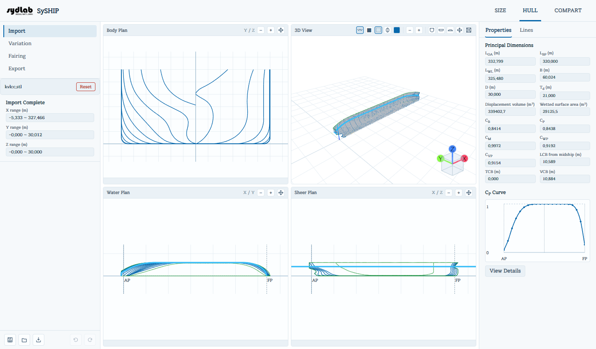

# SySHIP

**Early-stage ship design, from owner's requirements to damage stability, in one desktop app.**

SySHIP is a desktop application for the concept and preliminary design of ships, developed at the Seoul National University Ship Design Laboratory (**SyDLab**). It follows the way a design actually progresses: size a new ship from the owner's requirements, take a hull surface and reshape it toward the target dimensions, then lay out the internal compartments and check hydrostatics, loading, and damage stability, without leaving the application.

## Manual

The SySHIP manual is on Notion, in English and Korean.

[English manual](https://hissing-breeze-af7.notion.site/SySHIP-Documentation-416d64a418ff81198d0bf27cfad776da){ .md-button .md-button--primary }
[한국어 매뉴얼](https://hissing-breeze-af7.notion.site/SySHIP-416d64a418ff81e292f3ecdb0455418b){ .md-button }

## Stages

| Stage | What it does |
|---|---|
| **SySIZE** | Size a new design from owner's requirements and a parent ship: principal dimensions, freeboard, resistance and propeller, engine selection, and automatic optimization. |
| **SyHULL** | Import an STL hull, generate its lines plan, reshape it with free-form deformation, fair it, and export STL or DXF. |
| **SyCOMPART** | Model compartments and tanks inside the hull, then run hydrostatics, loading conditions, damage cases, and stability evaluation against IMO, MARPOL, and ICLL criteria. |

## Features

**SyHULL: hull form**

- STL import with scale and orientation, plus automatic stations, waterlines, and buttocks
- Free-form-deformation **variation** toward target dimensions and Cp curve, with protected regions
- Line **fairing** and STL / DXF export

**SyCOMPART: compartments and stability**

- Compartment modeling with boxes, cylinders, planes, lofted surfaces, boolean operations, and batch scripts
- Hydrostatics over a draft / trim / heel sweep, with a shell-thickness allowance
- Cargo definitions (category, reduction, filling, permeability) and loading conditions with lightweight, deadweight, and displacement summary
- Damage conditions and stability evaluation with a rule library you can edit, covering IMO, MARPOL, and ICLL criteria
- Merged STL export of the modeled compartments

**Automation**

- The full `syship` command line: script repeated studies, drive SySHIP from Python, or let an AI agent operate it. The window shows each command as it runs, or run headless for speed.

## Download

Get the latest installer from the **[Releases](https://github.com/Domiki/SySHIP/releases/latest)** page.

| Platform | File |
|---|---|
| Windows | `SySHIP-<version>-Windows.exe` |
| macOS | `SySHIP-<version>-MacOS.dmg` |

The app is not yet code-signed (Windows) or notarized (macOS), so the first launch may show a security warning. The manual's Installation page has the one-time fix for each system.

## Contributing

SySHIP's source code is not public, so this repository does not accept code contributions. You can still help:

- **Bug reports and feature requests**: open an [issue](https://github.com/Domiki/SySHIP/issues). Include your SySHIP version, operating system, and, when possible, the steps (and a sample file) to reproduce the problem.
- **Documentation fixes**: the manual is on Notion, so report problems as an issue.

## License

SySHIP is proprietary software. It is distributed free of charge in binary form **for educational use only**, and its source code is not publicly available. Redistribution, reverse engineering, and commercial use are not covered by this distribution.

Copyright &copy; Seoul National University, SyDLab.
